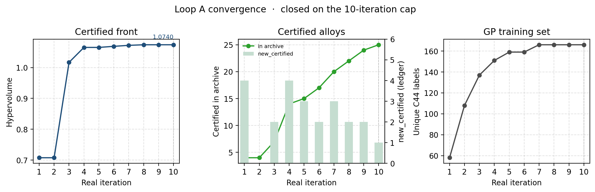
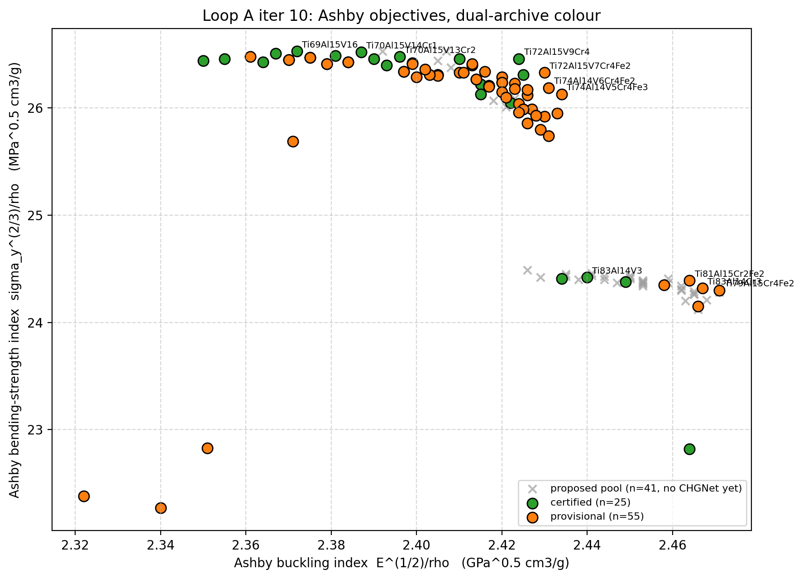
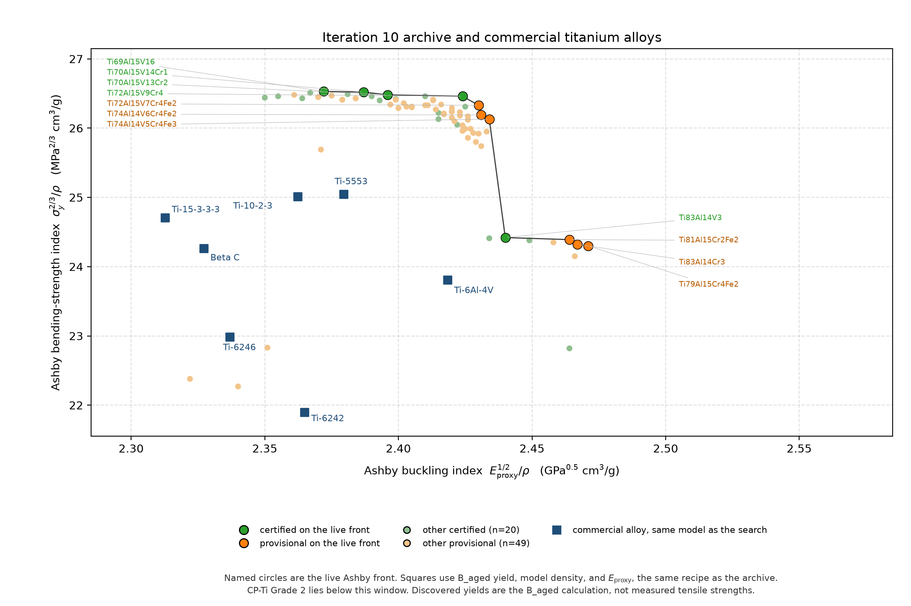

# Closed-loop titanium alloy design

This search looks for titanium alloys that raise both specific strength and specific stiffness, then checks each candidate for Born stability with CHGNet. Stages 1–7 were run once and frozen. Stage 8 repeated that physics for 10 real iterations and stopped.

Read this page first. The longer notes live in `results_archive/` and are linked below.

## What has been done

Stages 1–7 are frozen under the tag `v1.0-validated`. Stage 1 is the CrabNet screen in the sibling project `CrabNet_TiAlloy_Test`. This repository starts at Stage 2.

Stage 8 (Loop A) ran 10 real iterations. Iteration 10 hit the pre-registered safety cap. The other stopping rule, two stagnant iterations, did not fire. The closing commit is `cebf7ee`. The tag is `v2.0-loop-closed`. The paper figures and stage notes were added in `a17ac8c`.

Do not start iteration 11. Do not change `K`, `HV_EPS`, or `MAX_ITER` in `stage8_iteration/stopping_check.py` after seeing these results.

## Eight stages, and the picture of one iteration

`results_archive/flowchart_stages.png` is the map of Stages 1–8. Stage 6 is drawn twice because the frozen pipeline ranked the CrabNet table before CHGNet and ranked again after the elastic ensemble.

`results_archive/flowchart_loopA.png` is the inside of Stage 8 only. Its boxes are named by the job they do: propose, make it legal, drop known alloys, choose the CHGNet queue, file the result, update the Ashby front, datasheet lock, then stop or continue. A stage badge on a box means that step reuses a frozen model.

Each iteration reuses the Stage 3–6 models on new formulas and must pass the Stage 7 datasheet check before anything is committed. CrabNet is not called inside the loop.

| | Stages 1–8 | One iteration (`flowchart_loopA.png`) |
|---|---|---|
| What it is | The whole research pipeline | The body of Stage 8 |
| How often | Stages 1–7 once; Stage 8 ten times | Once per real iteration |
| Picture | `flowchart_stages.png` and `flowchart_stage_details.png` | `flowchart_loopA.png` |
| Write-up | `results_archive/stages_1_to_8.md` | `results_archive/methods_loopA.md` |

## Results at the close

Certified archive: 25 alloys, each with at least 9 CHGNet runs and a Born-violation fraction below 0.20. Provisional archive: 55. Live Ashby front: 11 (certified and provisional together). Certified-only front, the set used for hypervolume: 8. Certified-front hypervolume: 1.0740, unchanged from iteration 8. Reference point: (21.0, 2.25).

The strength-arm leader is **Ti69Al15V16** (metastable-β, 9 runs, violation fraction 0.00): Ashby indices 26.53 / 2.372, B_aged yield 1284 MPa, density 4.453 g/cm³, specific strength 288.3 MPa·cm³/g. That is +16.1% versus the upper Ti-6Al-4V datasheet value, 1100 MPa / 4.43 g/cm³ = 248.3 MPa·cm³/g. This yield is the declared B_aged scenario at a 10 µm reference grain. It is not a measured tensile test.

The hypervolume rose quickly through iteration 4 and then flattened. Iterations 6–10 still certified alloys, but those points sit inside the existing front. The cap, not a growing frontier, ended the search.





Green circles on that slide are certified. Orange circles are provisional. Gray crosses are that iteration’s proposals that did not enter either archive. The vertical-axis unit on this file says `MPa^0.5`. The index drawn there is `σ_y^(2/3) / ρ`. Leave the file as the loop wrote it.



`results_archive/fig_iter10_vs_commercial.png` is the comparison to use in the paper. Named circles are the live front. Smaller markers are the other certified and provisional alloys. Squares are the Stage 7 commercial alloys scored with the same recipe as the search: B_aged yield, model density, and `E_proxy`. The bending index is labeled `σ_y^(2/3) / ρ`. CP-Ti Grade 2 lies below the window. Rebuild it with `py -3.11 stage8_iteration/plot_final_iteration.py`. That script does not run the loop.

The full certified-front table, the iteration 9–10 interior certifications, and the 11-member live front are in `results_archive/certified_leader_cards.md`.

## Reading order

1. This page.
2. `results_archive/flowchart_guide.md` with `flowchart_stages.png`, `flowchart_stage_details.png`, and `flowchart_loopA.png` — what each block does.
3. `results_archive/stages_1_to_8.md` — the stage notes.
4. `results_archive/methods_loopA.md` — one iteration, in prose.
5. `results_archive/slide_loopA_convergence.png` and `results_archive/loopA_convergence_series.csv` — whether the front moved.
6. `results_archive/fig_iter10_vs_commercial.png` — the iteration-10 archive against the commercial alloys.
7. `results_archive/slide_loopA_iter010.png` and `results_archive/certified_leader_cards.md` — the loop slide and the alloy cards.
8. `data/iteration_log.csv`, `data/archive_certified.csv`, and `data/archive_provisional.csv` — the ledger and the two archives.

Code lives in `framework/` (shared constants and models) and in `stage2_export/` through `stage8_iteration/` (one folder per stage). This copy keeps the frozen tables, the iteration snapshots, the CrabNet gated table, the Stage 3 phase gates, the old v1 Pareto front, and the per-iteration CHGNet queues and bands (`data/tier_*_it*_input.csv`, `data/stage4_uq_{raw,bands}_it*.csv`). The intermediate slides stay in [ClosedLoop_TiAlloy_Design](https://github.com/AIR2021Eric/ClosedLoop_TiAlloy_Design). Read the archives and the ledger first.

## Do not run

The search is closed. From the repo root, do not run:

```powershell
python stage8_iteration/run_iteration.py --iter-id 11
python stage8_iteration/loop_A_optimizer.py
```

Do not overwrite `data/stage4_uq_bands.csv`, `data/stage4_uq_raw.csv`, or `data/stage7_audit_report.csv`. New CHGNet output from the finished loop is already in the iteration-scoped files `data/stage4_uq_{raw,bands}_it<N>{S,F,U}.csv`.
